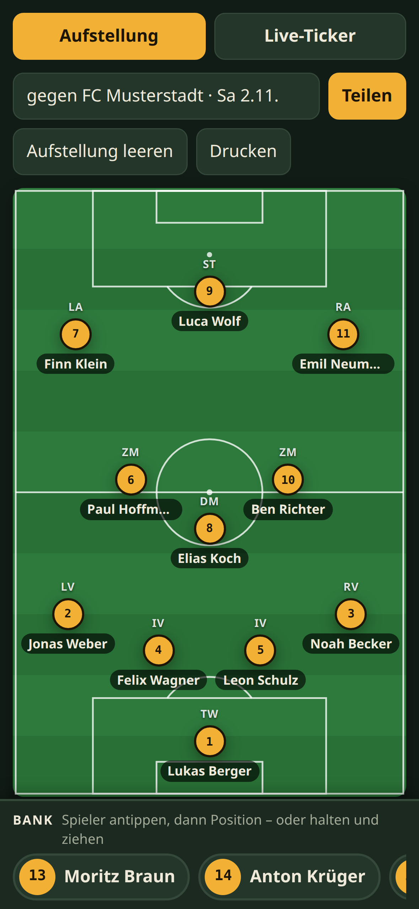
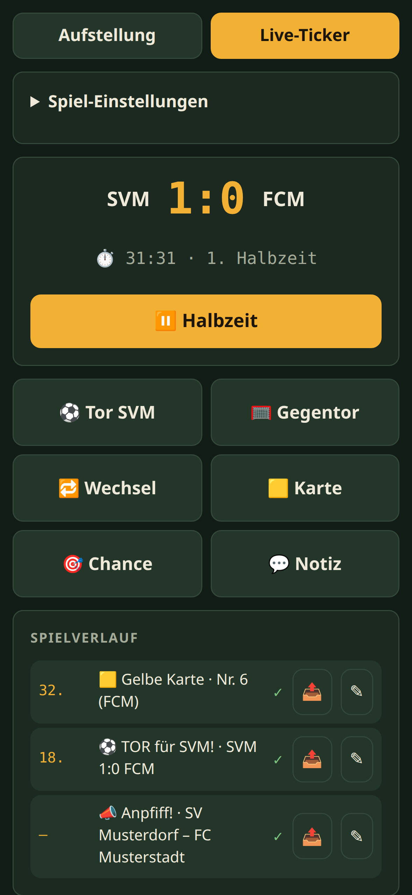
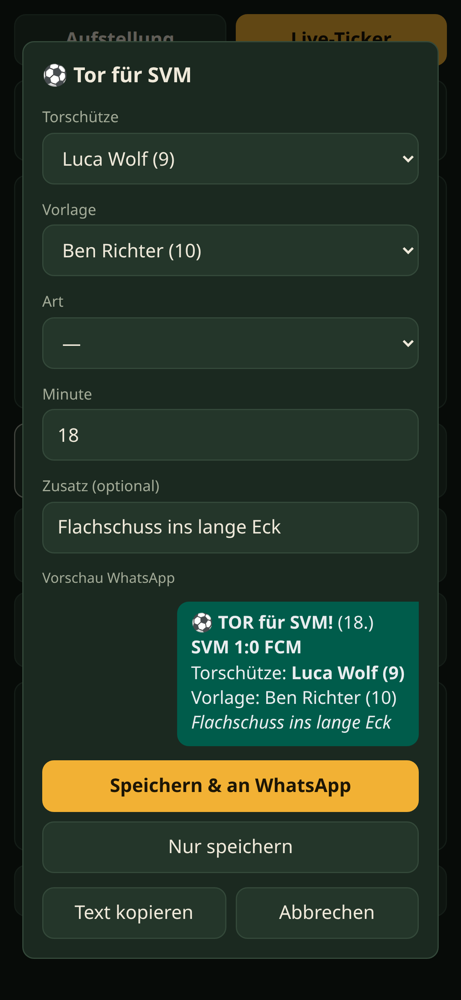
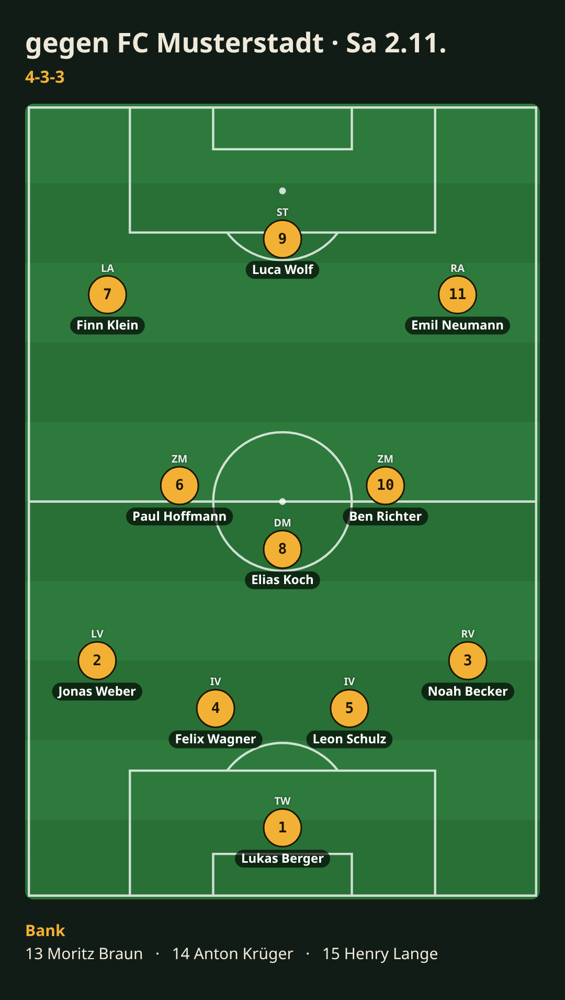

# ⚽ Torfunk

**Die Spieltag-App für den Amateurfußball – Aufstellung planen, Live-Ticker funken, alles direkt in die WhatsApp-Gruppe.**

Für alle an der Seitenlinie: Trainer stellen die Mannschaft auf, Ticker-Leute melden Tore, Karten und Wechsel – und Team, Eltern und Fans sind in der WhatsApp-Gruppe live dabei. Ohne Anmeldung, ohne Server, ohne Werbung.

👉 **Loslegen:** [jhoxyz.github.io/torfunk](https://jhoxyz.github.io/torfunk/)

<table>
  <tr>
    <td align="center"></td>
    <td align="center"></td>
    <td align="center"></td>
  </tr>
  <tr>
    <td align="center"><b>Aufstellung</b></td>
    <td align="center"><b>Live-Ticker</b></td>
    <td align="center"><b>WhatsApp-Vorschau</b></td>
  </tr>
</table>

## Was Torfunk kann

### 📋 Aufstellung
- **Kader anlegen** – Namen mit Rückennummer eintippen (`9 Max Müller`), auch ganze Listen mit Komma oder per Einfügen.
- **Formationen** – 4-4-2, 4-3-3, 4-2-3-1, 4-1-4-1, 4-4-2 Raute, 3-5-2, 3-4-3, 5-3-2. Positionen frei verschieben, umbenennen und als eigene Formation speichern.
- **Drag & Drop** – Spieler auf den Platz ziehen. Auf eine besetzte Position gezogen, wird ausgewechselt; zwei Spieler auf dem Platz tauschen die Plätze.
- **Fürs Handy gemacht** – Spieler antippen und dann die Position, oder kurz halten und ziehen. Die Bank ist unten immer griffbereit.
- **Verfügbarkeit** – Spieler als verletzt ✚, gesperrt oder nicht verfügbar markieren. Sie können dann nicht aufgestellt werden.
- **Formation wechseln, Aufstellung bleibt** – Torwart bleibt Torwart, Abwehr bleibt Abwehr.

### 📤 Teilen
- **Aufstellung als Bild** – mit Titel, Formation und Bank, direkt über das Teilen-Menü an WhatsApp (oder herunterladen bzw. kopieren).
- **Als Link** – wer den Link öffnet, sieht die Aufstellung und kann sie mit einem Tipp in den eigenen Planer übernehmen (z. B. Co-Trainer).
- **Drucken** – Aufstellung mit Bank für den Aushang in der Kabine.



### 📣 Live-Ticker
- **Spieluhr** mit Halbzeitlänge für Jugend und Senioren – ein großer Knopf führt durchs Spiel: Anpfiff → Halbzeit → 2. Halbzeit → Abpfiff.
- **Ereignisse mit einem Tipp** – Tor, Gegentor, Wechsel (auch Doppelwechsel und beim Gegner), Karte, Chance, Notiz. Minute und Spielstand werden automatisch eingetragen.
- **Gegner per Rückennummer** – Namen der gegnerischen Spieler braucht niemand.
- **Fertige WhatsApp-Nachrichten** – fett, kursiv, mit Emojis, z. B.:

  ```
  ⚽ *TOR für SVM!* (18.)
  *SVM 1:0 FCM*
  Torschütze: *Luca Wolf (9)*
  Vorlage: Ben Richter (10)
  ```

  Zum Anpfiff gibt's die Aufstellung, beim Abpfiff eine Zusammenfassung mit allen Toren, Karten und Wechseln.
- **Spielverlauf** – alles nachträglich korrigieren, erneut senden oder löschen.
- Wechsel und Platzverweise im Ticker **aktualisieren die Aufstellung** gleich mit.
- Das **Display bleibt an**, solange das Spiel läuft.

## Datenschutz

Torfunk läuft komplett im Browser. **Alle Daten – Kader, Aufstellungen, Spielverlauf – bleiben auf deinem Gerät.** Es gibt keinen Server, kein Konto und kein Tracking. Geteilt wird nur, was du selbst per WhatsApp oder Link verschickst.

Das heißt aber auch: Die Daten gibt es nur in dem Browser, in dem du sie eingegeben hast. Eine Sicherungs- und Umzugsfunktion steht auf der [Roadmap](ROADMAP.md).

## Tipps

- **Aufs Handy holen:** Seite öffnen → im Browser-Menü „Zum Startbildschirm hinzufügen“. Dann startet Torfunk wie eine App.
- **WhatsApp:** Beim Senden öffnet sich das Teilen-Menü – deine Mannschaftsgruppe steht meist ganz oben. Ein Tipp auf „Senden“ ist immer nötig; automatisch in Gruppen posten erlaubt WhatsApp nicht.
- **Uhr zu spät gestartet?** Auf die Spieluhr tippen und die aktuelle Minute eintragen.

## Für Entwickler

Torfunk ist bewusst eine **einzige HTML-Datei** (`index.html`) – ohne Frameworks, ohne Build-Schritt, ohne Abhängigkeiten. Datei im Browser öffnen, fertig.

```bash
# lokal ausprobieren
python3 -m http.server 8080

# auf dem Handy testen (https, nötig fürs Teilen von Bildern)
python3 serve-https.py
```

`serve-https.py` erstellt beim ersten Start eine lokale Zertifizierungsstelle und zeigt an, wie man das Zertifikat einmalig aufs Handy bekommt.

Projektregeln für Mitwirkende und KI-Assistenten stehen in [`AGENTS.md`](AGENTS.md), geplante Funktionen in der [`ROADMAP.md`](ROADMAP.md).

## Ideen & Fehler

Fehler gefunden oder eine Idee? Gern als [Issue](https://github.com/jhoxyz/torfunk/issues) melden.
